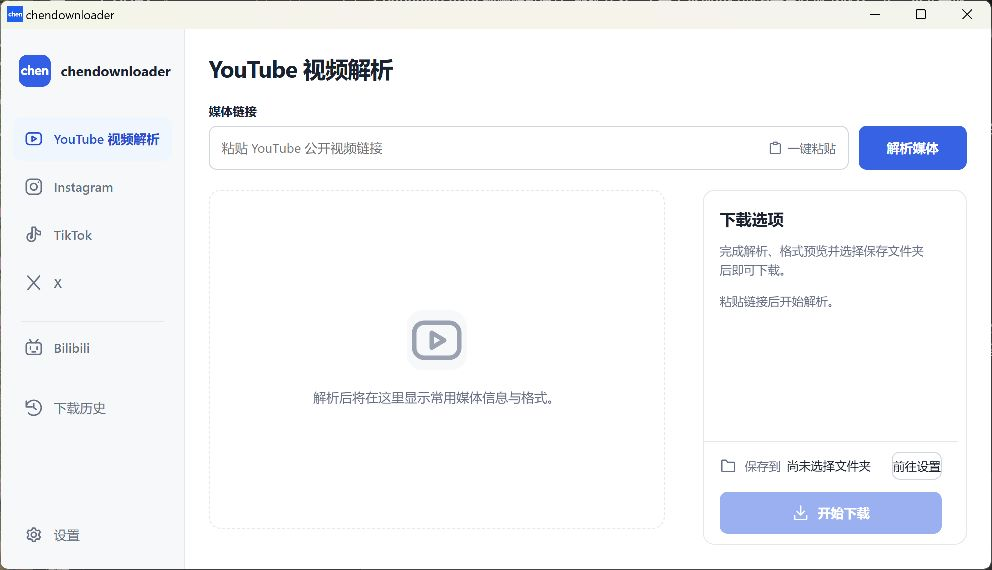

# chendownloader


[简体中文](#简体中文) · [English](#english)

## 简体中文

本地运行的 Windows 多平台媒体下载器。支持 YouTube、Instagram、TikTok、X 和哔哩哔哩，完整解压后即可使用，无需安装本应用或单独下载运行组件。

[下载 Windows x64 便携包](https://github.com/Chenchen96121/chendownloader/releases/latest) · [查看发布页](https://github.com/Chenchen96121/chendownloader/releases/latest)



### 支持平台

| 平台 | 支持内容 | 下载选项 |
| --- | --- | --- |
| YouTube | 公开单视频 | 最高质量、手动分辨率/容器、仅视频、仅音频，支持片段剪切 |
| Instagram | 公开帖子、Reels，包含图片和视频 | 最高质量单项、所选或整帖下载 |
| TikTok | 公开视频、图片图集 | 最高质量单项、所选或整帖下载 |
| X | 公开帖中的图片、视频和动图视频 | 最高质量单项、所选或整帖下载 |
| 哔哩哔哩 | 普通 BV/av 视频及指定单个 P | 最高质量、手动分辨率/容器、仅视频、仅音频，支持片段剪切 |

### 主要功能

- 默认下载平台当前提供的最高可用原始音视频流，不默认转码、降分辨率、改帧率或重新压缩。
- 根据实际编码无损封装，优先使用 MP4，其次 WebM，必要时使用 MKV。
- 兼容模式默认关闭；主动开启后可转换为 H.264 + AAC + MP4。
- 支持封面/媒体预览，常用来源信息和可展开的详细信息。
- 五个平台共用任务队列，默认同时下载 2 项，可在设置中调整为 1–4 项；任务可独立取消，切换平台不打断已提交任务。
- 默认简体中文，可切换英文；下载目录、语言和并发偏好保存在本机。
- 解析预览与下载选项独立滚动，窗口整体保持固定高度。

“最高质量”指平台当前向该用户提供的最高可用质量，不代表创作者上传前的原始文件。

### 使用方法

1. 下载 **chendownloader-1.1.0-windows-x64.zip**，而不是 GitHub 自动生成的 Source code 压缩包。
2. 完整解压到普通文件夹，运行 **chendownloader.exe**。
3. 在设置中选择默认下载目录。
4. 选择平台，粘贴链接并解析，确认下载选项后开始下载。

可使用同名 `.zip.sha256` 文件核对压缩包摘要：

```powershell
Get-FileHash .\chendownloader-1.1.0-windows-x64.zip -Algorithm SHA256
```

系统要求：Windows 10 22H2 或 Windows 11 x64，以及 Microsoft Edge WebView2 Runtime。当前程序未做代码签名。

### 隐私与使用边界

媒体请求和文件保存均在用户电脑上完成，没有项目账号服务器、媒体中转服务或遥测。应用默认不读取浏览器 Cookie，不要求登录。升级或重新解压会继续读取本机偏好；下载历史和队列仅保留当前会话。退出应用会取消未完成任务，不支持跨重启续传。

当前支持匿名可访问的公开内容，不提供登录/Cookie 导入、会员/付费内容解锁、直播、播放列表、哔哩哔哩多 P 批量下载或扩展包安装。Instagram、TikTok 和 X 不提供剪切或手动分辨率选择。平台可用性受网络、代理和平台访问策略影响。请仅下载你有权保存的内容。

### 源码与许可

技术栈：Tauri 2、React、TypeScript、Rust、TikTok 本地辅助组件、yt-dlp、gallery-dl、Deno、FFmpeg/FFprobe。

[源码构建说明](docs/BUILD.md) · [第三方组件说明](THIRD_PARTY_NOTICES.md)

应用原创代码采用 [MIT 许可证](LICENSE)，署名 Chenchen96121。第三方组件保留各自许可。FFmpeg 对应源码与离线构建材料作为同次 Release 的独立附件提供，普通使用无需下载该附件。

---

## English

A local Windows media downloader for YouTube, Instagram, TikTok, X, and Bilibili. Extract the complete portable package to get started. No application installation or separate runtime component downloads are needed.

[Download the Windows x64 portable package](https://github.com/Chenchen96121/chendownloader/releases/latest) · [View the release](https://github.com/Chenchen96121/chendownloader/releases/latest)

### Supported platforms

| Platform | Supported content | Download options |
| --- | --- | --- |
| YouTube | Individual public videos | Highest quality, manual resolution/container selection, video only, audio only; supports downloading a selected time range |
| Instagram | Public posts and Reels, including images and videos | Highest-quality downloads of individual items, selected items, or the entire post |
| TikTok | Public videos and photo posts | Highest-quality downloads of individual items, selected items, or the entire post |
| X | Images, videos, and animated videos in public posts | Highest-quality downloads of individual items, selected items, or the entire post |
| Bilibili | Standard BV/av videos and a specified single part (P) | Highest quality, manual resolution/container selection, video only, audio only; supports downloading a selected time range |

### Features

- Downloads the highest-quality original audio/video streams currently available from the platform by default, without transcoding, reducing resolution, changing frame rate, or recompressing.
- Remuxes streams without re-encoding based on codec compatibility, preferring MP4, then WebM, and using MKV when needed.
- Compatibility mode is off by default. Enable it explicitly to convert to H.264 + AAC in MP4.
- Cover and media previews, essential source information, and expandable technical details.
- A shared download queue across all five platforms. Two concurrent tasks by default, adjustable from 1 to 4 in Settings. Cancel tasks independently and switch platforms without interrupting submitted tasks.
- Simplified Chinese by default, with an English option. Download folder, language, and concurrency preferences are saved locally.
- Independently scrollable preview and download-options panels within a fixed-height application layout.

“Highest quality” means the highest quality the platform currently makes available to the user, not the creator’s original file before upload.

### Getting started

1. Download **chendownloader-1.1.0-windows-x64.zip**, rather than the Source code archives generated by GitHub.
2. Extract the entire package into a regular folder and run **chendownloader.exe**.
3. Choose a default download folder in Settings.
4. Select a platform, paste a link, parse it, review the download options, and start downloading.

Verify the archive’s SHA-256 hash against the accompanying `.zip.sha256` file:

```powershell
Get-FileHash .\chendownloader-1.1.0-windows-x64.zip -Algorithm SHA256
```

System requirements: Windows 10 22H2 or Windows 11 x64, with Microsoft Edge WebView2 Runtime. The application is currently unsigned.

### Privacy and limitations

Media requests and file saving take place on your computer. The project runs no account server, media relay service, or telemetry. The application does not read browser cookies by default or require login. Upgrading or extracting a new copy continues to use your locally saved preferences. Download history and the queue last only for the current session. Exiting the application cancels unfinished tasks; resuming downloads across restarts is not supported.

Currently supports public content accessible anonymously. Login/cookie import, unlocking membership or paid content, live streams, playlists, Bilibili multi-part batch downloads, and extension installation are not available. Instagram, TikTok, and X do not offer time-range clipping or manual resolution selection. Availability depends on your network, proxy, and the platform’s access policies. Only download content you have permission to save.

### Source and licensing

Built with Tauri 2, React, TypeScript, Rust, yt-dlp, gallery-dl, Deno, and FFmpeg/FFprobe.

[Build instructions (Chinese)](docs/BUILD.md) · [Third-party notices (Chinese)](THIRD_PARTY_NOTICES.md)

Original application code is licensed under the [MIT License](LICENSE), credited to Chenchen96121. Third-party components retain their respective licenses. FFmpeg corresponding source and offline build materials are provided as a separate attachment in the same release; they are not required for normal use.

[Back to top / 返回顶部](#chendownloader)
